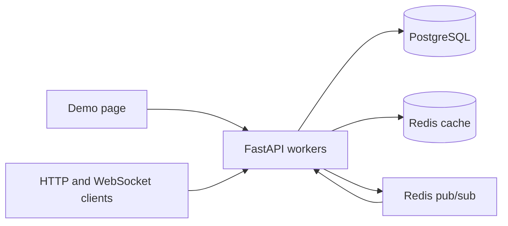

# Issue Tracker API

Async FastAPI issue tracker for a new-grad backend portfolio: workspaces, projects, issues, and comments, with a Redis cache, cross-worker WebSocket fanout, and a measured Postgres index on the list query.

**Live demo:** _deploy the Blueprint, then paste the service URL here._

Author: Anshul Palarpwar.

## Architecture



Each API worker is async end to end: async routes, async SQLAlchemy with asyncpg, and redis-py asyncio. Workers do not share memory. Cache reads and invalidations go through Redis, and live events are published on `project:{id}:events`. Every worker subscribes with `PSUBSCRIBE` and forwards messages only to the sockets connected to that process.

## Features

- Workspaces, members, projects, labels, issues, and comments
- Issue list filtered by project, state, assignee, and label
- Keyset pagination on `created_at DESC, id DESC` or `updated_at DESC, id DESC`
- API keys stored as SHA-256 hashes. Send `X-API-Key`
- `GET /issues/{id}` and `GET /projects/{id}/issue-counts` cached in Redis, with `X-Cache: HIT` or `MISS`, invalidated on writes
- WebSocket `/ws/projects/{project_id}` for `issue.created`, `issue.updated`, `issue.deleted`, and `comment.created`
- Structured errors, request validation, `/health`, and `/ready`
- Settings from environment variables

## Stack

Python 3.12, FastAPI, Pydantic v2, SQLAlchemy 2.x asyncio, asyncpg, Alembic, PostgreSQL 16, Redis 7, pytest, ruff, mypy, k6. Render deploy uses the free web, free Postgres, and free Key Value plans.

## Quickstart

```bash
python3 -m venv .venv
source .venv/bin/activate
pip install -e ".[dev]"
docker compose up -d --build
```

The API listens on port 8000. Copy `.env.example` to `.env` if you run uvicorn on the host instead of in Compose.

```bash
curl -s http://localhost:8000/ready
curl -s -X POST http://localhost:8000/api/v1/auth/register \
  -H "X-Bootstrap-Token: local-bootstrap-token" \
  -H "Content-Type: application/json" \
  -d '{"email":"ada@example.com","name":"Ada"}'
```

Registration is gated by `BOOTSTRAP_TOKEN`. The response includes an API key once. Interactive docs are at [/docs](http://localhost:8000/docs). A same-origin demo page at `/` subscribes to a project and creates an issue so you can see the event arrive over the socket.

Tests use the Compose Postgres database `issue_tracker_test` and Redis database 1:

```bash
make test
```

## API

All `/api/v1` routes require `X-API-Key` except `POST /api/v1/auth/register`, which requires `X-Bootstrap-Token`.

| Method | Path | Purpose |
| --- | --- | --- |
| POST | `/api/v1/auth/register` | Create a user and return an API key |
| GET | `/api/v1/auth/me` | Current user |
| POST, GET | `/api/v1/workspaces` | Create and list workspaces you belong to |
| POST | `/api/v1/workspaces/{id}/members` | Owner adds a member |
| POST, GET | `/api/v1/projects` | Create a project; list by `workspace_id` |
| GET | `/api/v1/projects/{id}/issue-counts` | Counts by state, cached |
| POST, GET | `/api/v1/projects/{id}/labels` | Labels |
| POST, GET | `/api/v1/issues` | Create, or list with filters and a cursor |
| GET, PATCH, DELETE | `/api/v1/issues/{id}` | Read, update, delete. GET is cached |
| POST, GET | `/api/v1/issues/{id}/comments` | Comments, keyset pagination |
| GET | `/health`, `/ready` | Liveness, and Postgres plus Redis readiness |

List example:

```bash
curl -s "http://localhost:8000/api/v1/issues?project_id=1&state=todo&limit=50" \
  -H "X-API-Key: $API_KEY"
```

The page is `{ "items": [...], "next_cursor": "..." }`. Pass `cursor` back unchanged. The cursor is an opaque encoding of the last row's sort timestamp and id. The handler fetches one extra row to decide whether `next_cursor` is set, so the SQL limit is 51 when the client asks for 50.

Errors look like:

```json
{"error": {"code": "not_found", "message": "Issue not found", "details": []}}
```

Unknown workspaces and projects return 404 for non-members, so existence is not leaked.

## WebSocket

```javascript
const url = new URL("/ws/projects/1", location.origin);
url.protocol = location.protocol === "https:" ? "wss:" : "ws:";
url.searchParams.set("api_key", apiKey);
const socket = new WebSocket(url);
socket.addEventListener("message", (event) => {
  console.log(JSON.parse(event.data));
});
```

Non-browser clients may send `X-API-Key` instead of the query parameter. A text frame of `ping` returns a `pong` event. A message looks like:

```json
{
  "type": "issue.created",
  "project_id": 1,
  "occurred_at": "2026-11-16T12:00:00.000000+00:00",
  "data": {"id": 10, "title": "Pagination drops the sort", "state": "todo"}
}
```

Delivery is at-most-once. Redis pub/sub is not a durable log. The write is committed before publish; a crashed worker can drop the live event while the row remains.

## Index experiment

The list used by a board is:

```sql
SELECT ... FROM issues
WHERE project_id = $1 AND state = $2
ORDER BY created_at DESC, id DESC
LIMIT 51
```

Authorization is a separate primary-key lookup, so this statement stays single-table. The baseline schema already has the foreign-key index on `issues.project_id`, the assignee index, and the unique `(project_id, number)` index. The experiment adds one composite index and changes nothing else:

```sql
CREATE INDEX ix_issues_project_state_created_id
    ON issues (project_id, state, created_at DESC, id DESC);
```

`state` is a column, not a `WHERE state = 'todo'` predicate, because every column is a real filter. A partial index would only help one state. `make bench` drops that index, runs `EXPLAIN (ANALYZE, BUFFERS)` and a fixed k6 load, creates the index, and runs both again. Plans and k6 summaries are written under `benchmarks/`. The README table is copied from those files and is not estimated.

Dataset, from `scripts/seed.py`: 500,000 issues, seed 42, 8 projects, 70% of issues in project `CORE`, states split 20/30/20/25/5 across backlog, todo, in progress, done, and cancelled. k6 is closed-loop: 10 virtual users, 30 seconds, 2 second graceful stop, no think time, `GET /api/v1/issues?project_id={CORE}&state=todo&limit=50&sort=created_at`. The API is one host uvicorn worker. Postgres 16 and Redis 7 run in Docker Compose with `shared_buffers=256MB`, `work_mem=4MB`, and `max_connections=100`.

The measured table is filled in after `make bench` from `benchmarks/load_before.txt`, `benchmarks/load_after.txt`, `benchmarks/explain_before.txt`, and `benchmarks/explain_after.txt`.

## Design decisions

- Bigint identity keys. They stay small in the index this experiment is about, and keyset pagination needs a stable tie-break next to `created_at`.
- The list query does not join memberships. A project the caller cannot see is rejected first, so the plan does not change when authz rules change.
- Cache keys are `issue:{id}` and `project:{id}:issue_counts`, with a 60 second TTL plus an explicit delete after a committed issue write. A failed delete is logged; the TTL bounds staleness. Deleting a project does not scan every cached issue. Those entries expire, and a later read checks that the project still exists before returning a hit.
- Issue numbers come from `projects.issue_counter` locked with `FOR UPDATE`. That serializes creates inside one project. A sequence per project would remove that hotspot.
- Registration stays closed unless `BOOTSTRAP_TOKEN` matches. The local Compose value is a dev token, not a production secret. On Render the token is `sync: false` and is set in the dashboard.

## Limitations

- Membership is the only authorization. There are no per-issue permissions.
- Comment edit and delete are not implemented.
- The composite index matches `sort=created_at` with an equality filter on `state`. `sort=updated_at` is correct and unindexed.
- Live events are at-most-once.
- Cache invalidation is delete-after-commit, not a lock that prevents a stale set from winning a race. The TTL is the backstop.
- Free Render Postgres expires 30 days after creation. After that it is inaccessible unless upgraded, and Render deletes it following a 14-day grace period. Free Key Value is in-memory and loses data on restart. The free web service sleeps after 15 minutes without traffic, runs as a single instance, and has an ephemeral disk.

## Deploy on Render

1. Push this repo to GitHub.
2. In the Render dashboard, New → Blueprint, and select the repo. Render reads `render.yaml`.
3. Confirm the three resources are all on the **free** plan: web service `issue-tracker-api`, Postgres `issue-tracker-db`, Key Value `issue-tracker-kv`. Do not accept a paid plan.
4. When Render prompts for `BOOTSTRAP_TOKEN`, set a long random value. It is not in the repo.
5. Deploy. `preDeployCommand` runs `alembic upgrade head`. The container also migrates on start and listens on `0.0.0.0:$PORT`.
6. Open `https://<service>.onrender.com/ready`, then register a user with the bootstrap token. Paste the service URL into the live-demo line at the top of this file.

`DATABASE_URL` and `REDIS_URL` are wired with `fromDatabase` and `fromService` to the internal addresses. The app rewrites `postgres://` to `postgresql+asyncpg://` and moves `sslmode` into asyncpg's SSL argument. Both data stores have `ipAllowList: []`, so they accept connections from the web service and not from the public internet.

Free-plan consequences that matter here: one free Postgres and one free Key Value per workspace, Postgres storage capped at 1 GB, no backups, no managed pooler, and the web service cannot scale past one instance. Redis pub/sub still has a point, because a paid scale-out would use the same code, but on the free tier there is only one worker and it sleeps when idle. WebSocket clients are disconnected when it spins down.

## Development

```bash
make lint     # ruff and mypy
make test     # Compose Postgres and Redis, then pytest
make seed     # 500,000 deterministic issues
make bench    # explain and k6, without the index and then with it
```

CI on `main` runs ruff, mypy, Alembic, pytest against Postgres and Redis service containers, and `docker build`.
